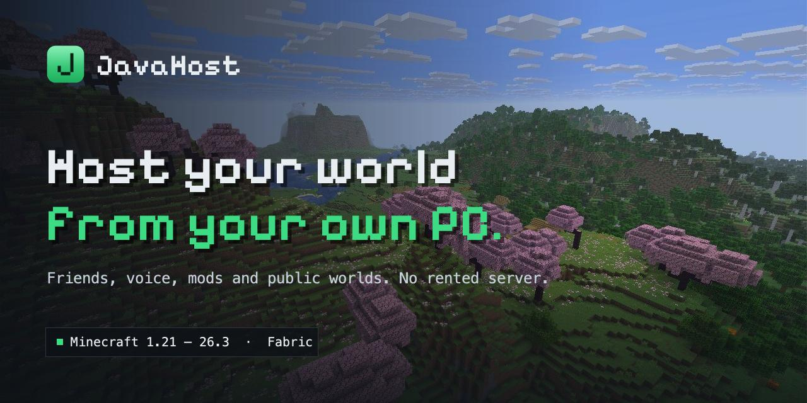
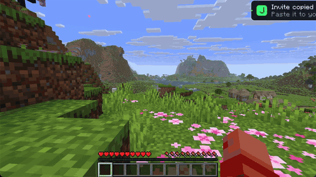
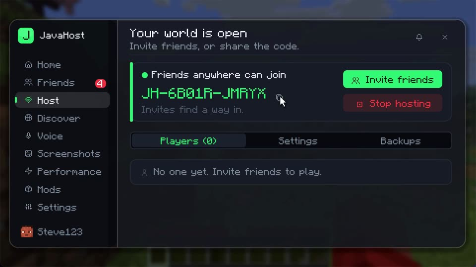
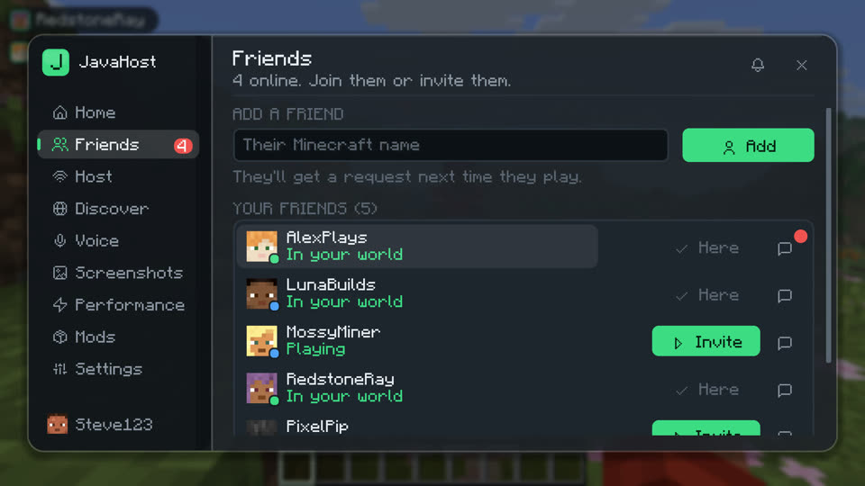
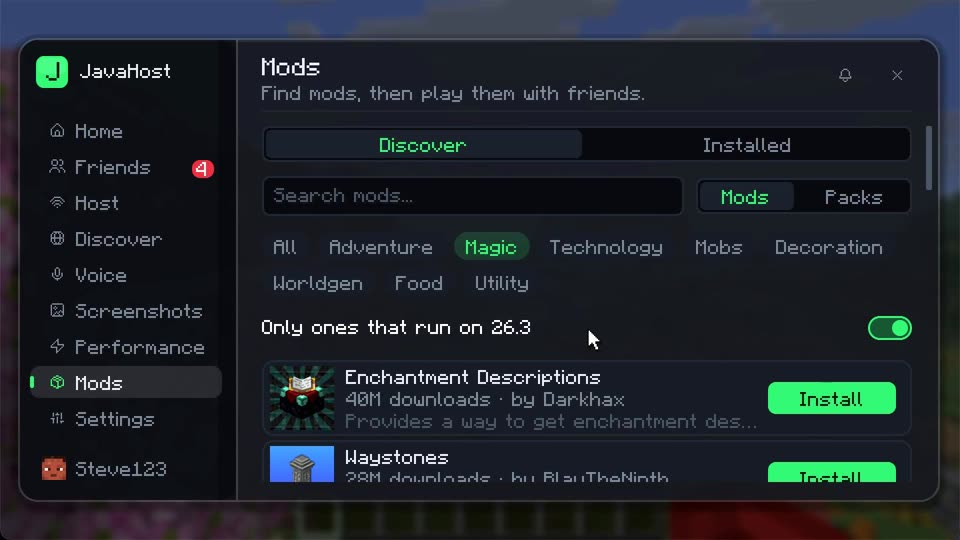
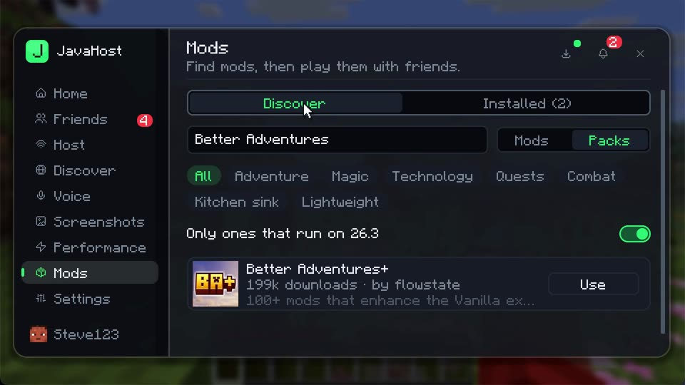
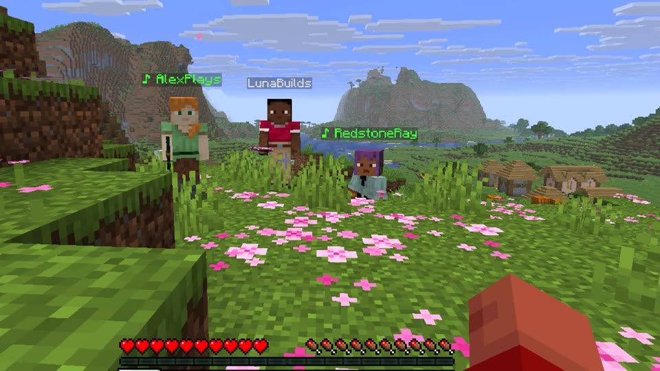
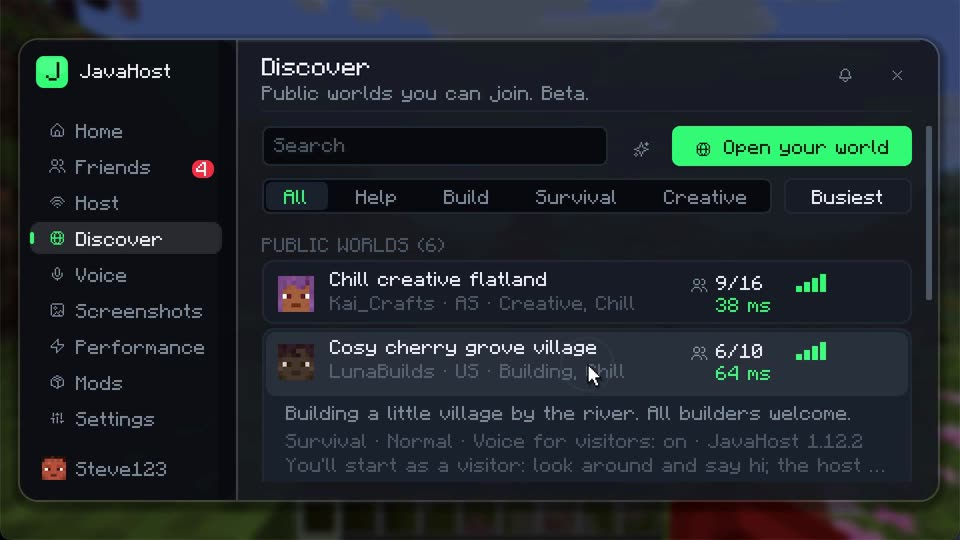

<p align="center">
  
</p>

<p align="center">
  A Fabric mod for playing Minecraft with friends in your own world. Host from your PC, invite friends in one click, talk with proximity voice, and share modded or public worlds. No rented server.
</p>

<p align="center">
  <a href="#install">Install</a> ·
  <a href="#features">Features</a> ·
  <a href="#demo">Demo</a> ·
  <a href="docs/HOW-IT-WORKS.md">How it works</a> ·
  <a href="CONTRIBUTING.md">Contributing</a>
</p>

<p align="center">
  <a href="https://github.com/IbrahimMas1/javahost/releases/latest"></a>
  <a href="https://github.com/IbrahimMas1/javahost/releases"></a>
  <a href="#supported-versions"></a>
</p>

---

## Install

1. Open the Minecraft Launcher once, then close it.
2. Download the installer from the [latest release](https://github.com/IbrahimMas1/javahost/releases/latest) and run it:
   - Windows: the `.exe`. If SmartScreen shows up, click More info, then Run anyway.
   - Mac: the `.dmg`. It isn't signed, so the first time, right-click the app and choose Open.
   - Linux or anything else with Java 21: `java -jar JavaHost-Installer.jar`
3. Pick your Minecraft version and any add-ons, then click Install.
4. Choose the JavaHost profile in the launcher and press Play. In game, press J to open the menu.

The installer puts Fabric, Fabric API and JavaHost in a separate profile and folder for each Minecraft version, so your normal game isn't touched. Run it again to update, add another version or uninstall. Your friends need JavaHost too for invites, voice and shared packs.

## Features

- **Hosting from your PC.** Start hosting tries your router (UPnP), IPv6, the free e4mc relay and LAN in turn, so it works on most networks without port forwarding.
- **Friends and invites.** Add friends by their Minecraft name and see who's online or hosting. Invite sends a Join button straight to their game, no codes needed.
- **Encrypted chat and screenshots.** Messages, invites and screenshots (F6) are end-to-end encrypted. There's no JavaHost server in the middle.
- **Proximity voice.** Push to talk (V) or voice activation, with voices that fade with distance. The host can switch the world to party voice so everyone hears everyone.
- **Mod store.** Search Modrinth mods and modpacks by category and install them from the menu, with download progress and a notification when they're done.
- **Modded worlds.** When a friend joins a modded world, JavaHost downloads the exact mods it needs for them. Their own mods are put aside and come back with one click.
- **Public worlds (beta).** List your world in Discover or join someone else's. Visitors play in Adventure mode until you trust them, and your address stays behind the relay.
- **Host controls.** Change game modes, kick or ban, and lock world rules like difficulty or keep inventory. Friends-only by default.
- **Extras.** Guests get your resource packs and shader settings (they're asked first), one-click performance mods, automatic backups, sending a world copy to a friend, and updates that install themselves.

## Demo

<p align="center">
  
</p>

<table>
<tr>
<td width="50%"><p align="center"><sub>Host: one invite code for every route</sub></p></td>
<td width="50%"><p align="center"><sub>Friends: see who's online and invite them</sub></p></td>
</tr>
<tr>
<td><p align="center"><sub>Mods: Modrinth mods and modpacks</sub></p></td>
<td><p align="center"><sub>A whole modpack, installed in one click</sub></p></td>
</tr>
<tr>
<td><p align="center"><sub>Proximity voice in game</sub></p></td>
<td><p align="center"><sub>Discover: public worlds to join</sub></p></td>
</tr>
</table>

## Supported versions

| JavaHost build | Minecraft |
|---|---|
| 26.3 | 26.3 |
| 26.2 | 26.2 |
| 26.1.2 | 26.1 to 26.1.2 |
| 1.21.11 | 1.21.11 |
| 1.21.10 | 1.21.9 to 1.21.10 |
| 1.21.8 | 1.21.6 to 1.21.8 |
| 1.21.4 | 1.21.4 |
| 1.21.1 | 1.21 to 1.21.1 |

Every build has the same features. Friends and invites work across versions, but joining a world needs the same Minecraft version. Fabric only.

## Building from source

You need Java 25.

```bash
git clone https://github.com/IbrahimMas1/javahost.git
cd javahost
./gradlew buildAll
```

The jars for each Minecraft version end up in `build/libs/<version>/`.

## Contributing

Bug reports, testing on other versions and small focused fixes are all welcome. When reporting a bug, [open an issue](https://github.com/IbrahimMas1/javahost/issues/new/choose) and paste the report from Settings → Copy debug report. See [CONTRIBUTING.md](CONTRIBUTING.md) for the project layout and tests.

## Security

Friend requests and invites travel through ntfy.sh, a public relay, and are signed with your Mojang-certified chat key. Private messages are end-to-end encrypted, and every join is checked against the host's key. Details are in [How it works](docs/HOW-IT-WORKS.md#safety). Please report vulnerabilities privately through [GitHub's security advisories](https://github.com/IbrahimMas1/javahost/security/advisories/new).

## License

MIT, see [LICENSE](LICENSE). Bundled libraries and credits are listed in [THIRD-PARTY-NOTICES.md](THIRD-PARTY-NOTICES.md).

Not an official Minecraft product. Not approved by or associated with Mojang or Microsoft.
