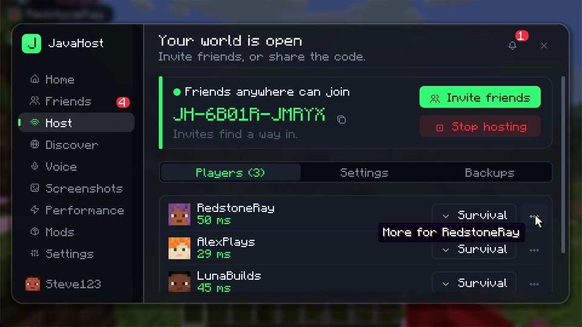

<div align="center">


# JavaHost

Friends, one-click invites, proximity voice, modded worlds and public worlds, for Minecraft Java Edition. No rented server.

[](https://github.com/IbrahimMas1/javahost/releases/latest) [](https://github.com/IbrahimMas1/javahost/releases) [](#supported-versions) [](https://fabricmc.net/) [](https://github.com/IbrahimMas1/javahost/actions/workflows/build.yml) [](LICENSE)

[**Download**](https://github.com/IbrahimMas1/javahost/releases/latest) · [Features](#features) · [Install](#install) · [FAQ](#faq) · [How it works](docs/HOW-IT-WORKS.md) · [Contributing](CONTRIBUTING.md)


</div>

## Why JavaHost?

Playing Minecraft with friends usually means renting a server, or fighting with port forwarding and IP addresses. JavaHost turns your singleplayer world into one your friends can join in one click, straight from your own PC. Press **J** in game and everything is there: friends, hosting, voice, mods and more.

## Features

<table>
<tr>
<td width="50%"></td>
<td>

### 🏠 Host from your own PC
Open your world and click **Start hosting**. JavaHost tries every way in, in turn, and gives you one invite code:
1. **Internet**: opens your router's port automatically (UPnP)
2. **IPv6**: direct, even behind shared connections (CGNAT)
3. **Relay**: a free relay (e4mc) when nothing direct works
4. **Same Wi-Fi**: for people at home

</td>
</tr>
<tr>
<td>

### 👥 Friends and one-click invites
Add a friend by their Minecraft name. See who's online, playing or hosting. Click **Invite** and their game shows a **Join** button. No codes, no links. Chat and screenshots (`F6`) are end-to-end encrypted.

</td>
<td width="50%"></td>
</tr>
<tr>
<td></td>
<td>

### 🎙️ Proximity voice
Push to talk (`V`) or voice activation, mute with `M`. Voices fade with distance and come from the speaker's direction. The host can switch the whole world to **party voice**, where everyone hears everyone.

</td>
</tr>
<tr>
<td>

### 📦 A mod store, built in
Browse Modrinth by category and install with one click, with download progress in the menu. Mods for other versions say where they run. Every file is checked against Modrinth's hash.

</td>
<td></td>
</tr>
<tr>
<td></td>
<td>

### 🧩 Modded worlds
Play any Fabric mods or modpack with friends. When someone joins without them, JavaHost shows exactly which mods the world needs and downloads the very same files. Their own mods are put aside safely and come back any time.

</td>
</tr>
<tr>
<td>

### 🌍 Public worlds *(beta)*
List your world in **Discover**, or join someone else's. Strangers visit in Adventure mode until you **Trust** them, and your address stays hidden behind the relay.

</td>
<td></td>
</tr>
<tr>
<td></td>
<td>

### 🛡️ Your world, your rules
Change a player's game mode, trust, kick or ban. Friends-only by default. World rules (difficulty, keep inventory, PvP…) can be locked for a challenge run, and every change is announced.

</td>
</tr>
</table>

**And also:**
- **Shared look:** guests get the host's resource packs and Iris shader settings, with permission first.
- **More frames:** Quick Tune, and Sodium, Lithium, FerriteCore, ImmediatelyFast and Entity Culling in one click.
- **Backups:** a backup when friends join, restored in one click. Send a friend a copy of any world.
- **Automatic updates:** signed, checked file by file, installed when you close the game. You can always go back one version.
- **Every version:** one installer for Minecraft 1.21 to 26.3, with a separate profile for each.

## Install

1. Open the **Minecraft Launcher** once, then close it.
2. Download the installer from the [latest release](https://github.com/IbrahimMas1/javahost/releases/latest) and run it:
   - **Windows:** the `.exe`. If SmartScreen appears, choose **More info → Run anyway**.
   - **Mac:** open the `.dmg` and run the app. It's unsigned, so the first time right-click it and choose **Open**.
   - **Anything else with Java 21+:** `java -jar JavaHost-Installer.jar`.
3. Pick your **Minecraft version** and add-ons, then click **Install**.
4. In the launcher, choose the **JavaHost** profile and press **Play**. Press **J** in game.

The installer sets up Fabric, Fabric API, JavaHost and your add-ons in their own profile and folder for each Minecraft version, so your normal Minecraft is never touched. Run it again to update, add another version or uninstall. Friends need JavaHost too for invites, voice and shared packs: send them the installer.

## Supported versions

| JavaHost build | Minecraft |
|---|---|
| 26.3 | 26.3 |
| 26.2 | 26.2 |
| 26.1.2 | 26.1 – 26.1.2 |
| 1.21.11 | 1.21.11 |
| 1.21.10 | 1.21.9 – 1.21.10 |
| 1.21.8 | 1.21.6 – 1.21.8 |
| 1.21.4 | 1.21.4 |
| 1.21.1 | 1.21 – 1.21.1 |

Every build has the same features. Friends, chat and invites work across versions; joining a world needs the same Minecraft version. Fabric only: Forge and NeoForge can't load JavaHost.

## FAQ

<details>
<summary><b>Do my friends need JavaHost too?</b></summary>

For one-click invites, voice, shared packs and modded worlds, yes. Players without mods can still join through the relay address.
</details>

<details>
<summary><b>Is there a JavaHost server that sees my messages?</b></summary>

No. Requests and invites travel through ntfy.sh, a free public relay, signed with your Mojang-certified chat key. Invites, chat and screenshots are end-to-end encrypted with a key only you and that friend share. See [How it works](docs/HOW-IT-WORKS.md).
</details>

<details>
<summary><b>What if my router blocks everything?</b></summary>

JavaHost checks every route and falls back to the free e4mc relay. The Host tab shows which ways work.
</details>

<details>
<summary><b>Will it mess up my normal Minecraft or my mods?</b></summary>

No. Each Minecraft version gets its own JavaHost profile and folder. When you join a modded world, your own mods are moved aside (never deleted) and restored with one click.
</details>

<details>
<summary><b>Why is my microphone silent on Mac?</b></summary>

Give the Minecraft Launcher microphone access in System Settings → Privacy & Security → Microphone.
</details>

<details>
<summary><b>How do I report a bug?</b></summary>

[Open an issue](https://github.com/IbrahimMas1/javahost/issues/new/choose) and attach the report from **Settings → Copy debug report** (it leaves out addresses and names).
</details>

## Building from source

Requires Java 25.

```bash
git clone https://github.com/IbrahimMas1/javahost.git
cd javahost
./gradlew buildAll   # jars for every Minecraft version in build/libs/<version>/
```

See [CONTRIBUTING.md](CONTRIBUTING.md) for the project layout, tests and the release process.

## Credits

- Icons: [Pixelarticons](https://github.com/halfmage/pixelarticons) by Gerrit Halfmann (MIT).
- Voice: [Concentus](https://github.com/lostromb/concentus), a pure-Java Opus codec (BSD-3-Clause).
- Mod icons: [TwelveMonkeys ImageIO](https://github.com/haraldk/TwelveMonkeys) for WebP (BSD-3-Clause).
- Relay: [e4mc](https://modrinth.com/mod/e4mc). Mods and modpacks: [Modrinth](https://modrinth.com/).

See [THIRD-PARTY-NOTICES.md](THIRD-PARTY-NOTICES.md).

## License

[MIT](LICENSE).

*Not an official Minecraft product. Not approved by or associated with Mojang or Microsoft.*
